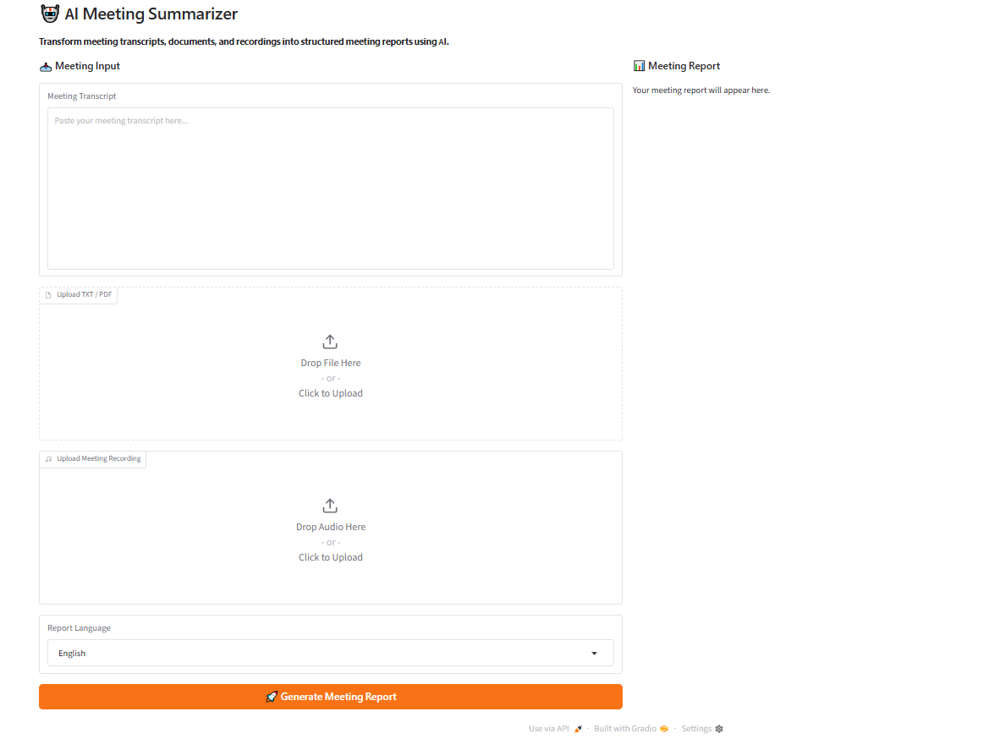
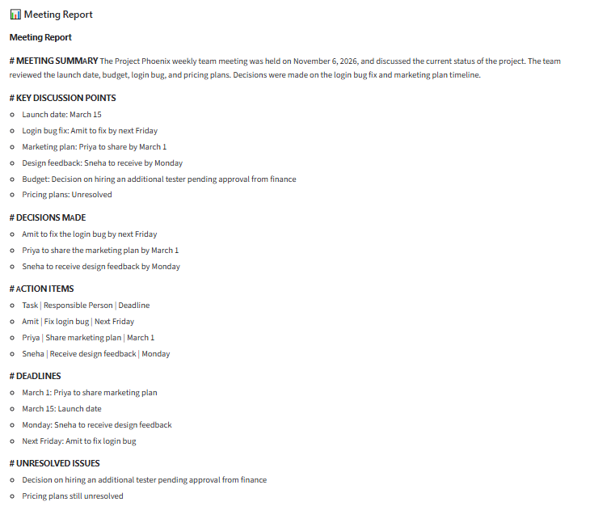
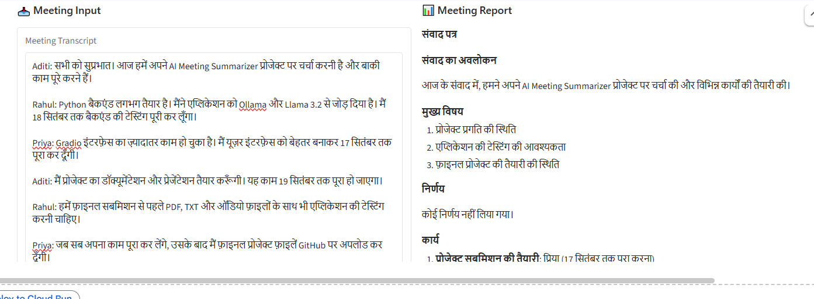
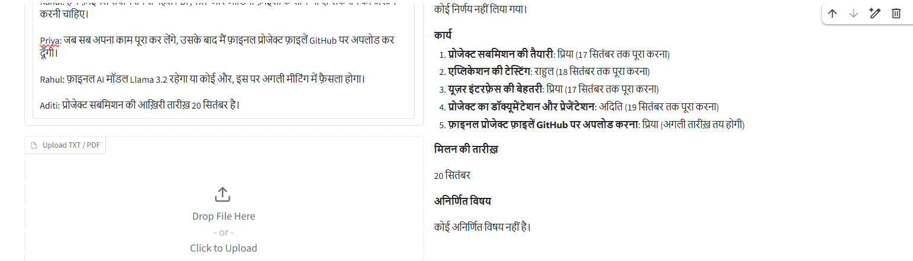

# 🤖 AI Meeting Summarizer

Turn meeting transcripts, documents (TXT/PDF) and audio recordings into a structured meeting report, running fully locally with **Ollama (Llama 3.2)** and **Whisper**, with a **Gradio** web UI.

## Features
- Paste a transcript, upload a TXT/PDF, or upload an audio recording
- Audio transcription with OpenAI Whisper
- Report sections: Summary, Key Discussion Points, Decisions, Action Items, Deadlines, Unresolved Issues
- Report language selection (English, Hindi, Spanish, French, German, Italian, Portuguese, Thai)

## Requirements
- Python 3.9+
- [Ollama](https://ollama.com) installed
- [ffmpeg](https://ffmpeg.org) (needed by Whisper for audio)

## Run locally
```bash
# 1. Install dependencies
pip install -r requirements.txt

# 2. Start Ollama and download the model
ollama serve          # in a separate terminal
ollama pull llama3.2

# 3. Launch the app
python app.py
```
Open the local URL printed in the terminal.

## Run on Google Colab
```python
!apt-get update -qq
!apt-get install -y zstd ffmpeg -qq
!curl -fsSL https://ollama.com/install.sh | sh
!pip install -q gradio pypdf openai-whisper requests

import subprocess, time, requests
subprocess.Popen(["ollama", "serve"], stdout=subprocess.DEVNULL, stderr=subprocess.DEVNULL)
for _ in range(30):
    try:
        requests.get("http://localhost:11434", timeout=2); break
    except Exception:
        time.sleep(1)

!ollama pull llama3.2
!git clone https://github.com/YOUR-USERNAME/ai-meeting-summarizer.git
%cd ai-meeting-summarizer
!python app.py
```

## Configuration
Edit the top of `app.py`:

## Screenshots
### Home


### Meeting Report (English)


### Hindi Support


- `OLLAMA_MODEL` – change the LLM
- `WHISPER_MODEL_SIZE` – `base` (fast) or `small` (better for Hindi)

## License
MIT
